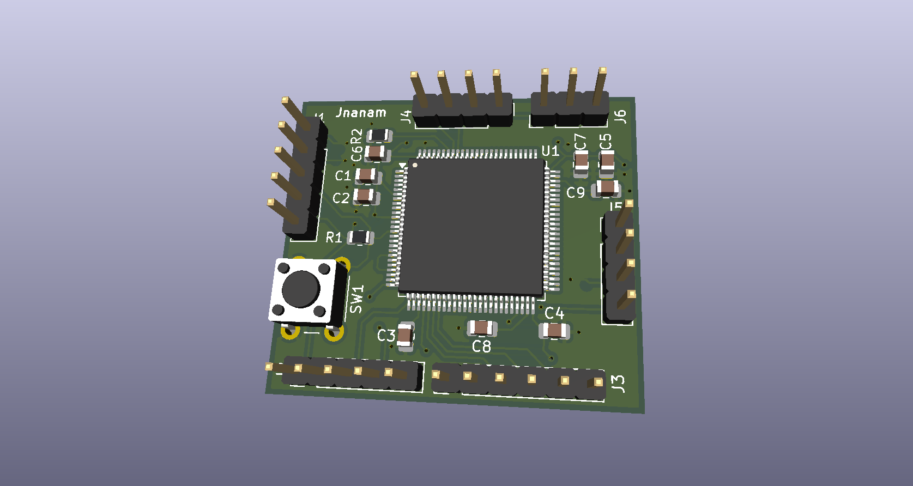
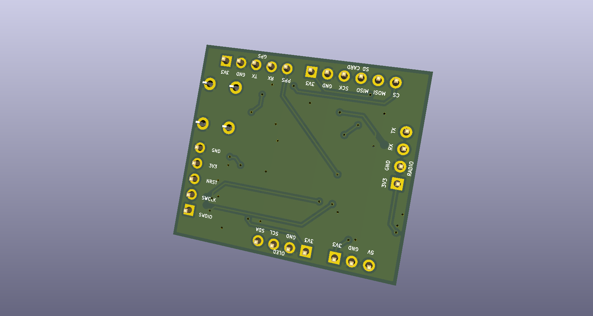
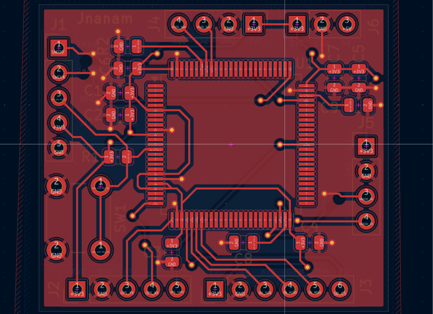
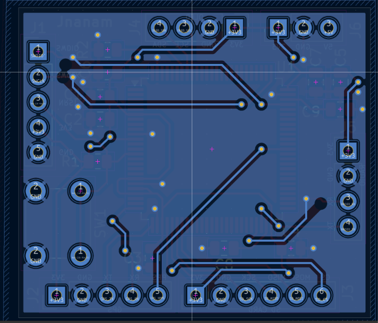

# STM32-GPS-CubeSat

Custom STM32-based PCB design featuring GPS-related signal connections and peripheral connectivity, designed using KiCad. This repository contains the KiCad source files, generated manufacturing outputs, bill of materials, design reports, and board visualizations.

## Project overview

The design is centered on an STM32F407VGTx microcontroller. The schematic and board provide labeled connections for GPS- and radio-related signals, microSD, an OLED display, debugging, and power input. The repository documents the PCB design; it does not establish that the board has been assembled, programmed, or functionally tested.

## Project objectives

- Organize the KiCad schematic and PCB design for review and reuse.
- Provide the interfaces and connector signals represented in the schematic, including GPS-, radio-, storage-, display-, debug-, and power-related connections.
- Include the generated Gerber/drill outputs, BOM, design-check reports, and board views alongside the design sources.

These points describe the files in this repository and do not imply verified operation of attached modules or systems.

## Hardware specifications

- **Main component:** STM32F407VGTx, shown as U1 in the schematic and BOM; the BOM identifies an LQFP-100 footprint.
- **Other listed components:** passive capacitors and resistors, a push-button switch, and connectors for the interfaces named below.
- **Power:** the schematic/BOM identify an `EPS_POWER_INPUT` connector. No input-voltage range or power-performance specification is stated in the supplied files.

## PCB design overview

KiCad design sources are in `Hardware/Schematic/` and `Hardware/PCB/`. The supplied fabrication outputs include front- and back-copper, solder-mask, paste, silkscreen, and edge-cut Gerbers. PCB renderings and layer illustrations are provided below.

## Communication interfaces

The schematic labels include:

- **microSD (SPI-labeled signals):** `SD_MOSI`, `SD_MISO`, `SD_SCK`, and `SD_CS`; the BOM lists a `MICROSD_SPI` connector.
- **OLED (I²C-labeled signals):** `OLED_SDA` and `OLED_SCL`; the BOM lists an `OLED_I2C` connector.
- **GPS-related labels:** `GPS_TX`, `GPS_RX`, and `GPS_1PPS`.
- **Radio-related labels:** `RADIO_TX` and `RADIO_RX`.
- **Debug:** `SWDIO'` and `SWCLK` labels and a `SWD_DEBUG` connector are present.

These are labels/connectors in the design files; no protocol configuration, attached module, or functional test result is asserted here.

## PCB 3D visualizations

| Front | Back |
|---|---|
|  |  |

## PCB layout images

| Front layer | Back layer |
|---|---|
|  |  |

## Repository structure

```text
README.md
Hardware/
├── Schematic/       KiCad schematic
├── PCB/             KiCad board and project settings
│   └── Gerber/      Gerbers, drill files, and Gerber job file
├── BOM/             Bill of materials CSV
└── Design_Reports/  ERC and DRC reports
Images/              PCB renderings and layer views
```

## Manufacturing files

Generated manufacturing outputs are in `Hardware/PCB/Gerber/`: the `.gbr` layer files, `.drl` plated/non-plated drill files, and `.gbrjob` job file. Confirm these outputs against the intended manufacturer and the current design before ordering; their presence alone is not a fabrication-readiness claim.

## Design verification

The included ERC report records **0 errors and 0 warnings**. The included DRC report records **0 DRC violations**, but also reports **64 unconnected pads**. These reports are dated 2026-10-23 and are provided as captured; they do not establish that the design is fabrication-ready. Review the unconnected pads and rerun checks on the final design before fabrication.

## Excluded files

KiCad local settings, lock files, autosaves, backups, and temporary files are excluded from version control. The original workspace also contains unrelated documents; they are not part of this repository.

## License

The hardware design files in this repository are provided under the CERN Open Hardware Licence Version 2 - Permissive (CERN-OHL-P-2.0). See [LICENSE](LICENSE) for the full text.
